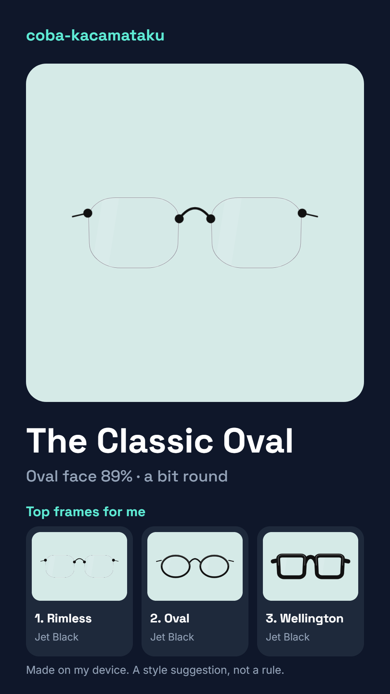

# 👓 coba-kacamataku — Face-Shape Glasses Finder & Live Try-On


A web app that tells you which **glasses shapes** and **frame colors** suit your face, then lets you try them on live. It reads your face shape and skin tone from one selfie, ranks 16 frame styles and 28 colors with plain-language reasons, and draws the frames on your face. Everything runs in the browser: **your photo never leaves your device**, and nothing is uploaded or stored.

> 🌐 **Live demo:** not deployed yet (see [Deploy](#-deploy)).
> Results are **style suggestions, not rules**.

## 📌 Table of Contents

- [Overview](#-overview)
- [Preview](#-preview)
- [Key Features](#-key-features)
- [How It Works](#-how-it-works)
- [Recommendation Engine](#-recommendation-engine)
- [3D Try-On (Beta)](#-3d-try-on-beta)
- [Tech Stack](#-tech-stack)
- [Privacy & Data](#-privacy--data)
- [Project Structure](#-project-structure)
- [Getting Started Locally](#-getting-started-locally)
- [Testing & Evaluation](#-testing--evaluation)
- [Deploy](#-deploy)
- [Status & Known Gaps](#-status--known-gaps)
- [License](#-license)

## 📖 Overview

Choosing glasses is hard: the right shape depends on your face, and the right color depends on your skin tone, and shop mirrors only show you one pair at a time. coba-kacamataku turns one selfie into measurements (face length, jaw, cheekbones, forehead), a soft face-shape estimate, a skin depth and undertone estimate with a confidence level, and a ranked list of frames with a reason for each pick. You can then try any of 5,376 generated frame variations on yourself, live or on your photo, and make a share card.

All frames are **generated in code** (no brand images, no copyrighted assets).

## 📸 Preview

| Share card (no photo) | Share card (with photo) |
|---|---|
|  | See `docs/m9/share-card-with-photo.png` |

More screenshots, per milestone, are in [`docs/`](docs/).

## 🌟 Key Features

- 🧑 **Face shape from landmarks:** 478 MediaPipe landmarks give length, jaw, cheek and forehead ratios. A soft classifier shows the likeliest shape *and* the runner-up (oval, round, square, oblong, heart, diamond), including "between two shapes" cases.
- 🎨 **Skin tone & undertone:** CIELAB analysis of skin patches with a **confidence** level. Low confidence asks you to retake the photo and says why (too dark, yellow light, and so on).
- 🕶️ **Rule-based frame ranking with reasons:** 16 styles (round, panto, oval, rectangle, square, wayfarer, browline, aviator, cat-eye, butterfly, hexagon, octagon, half-rim, rimless, shield, wellington) and 28 colors, each pick explained in plain words. Taste chips (Minimal, Classic, Bold) and 👍 / 👎 adjust the list.
- 📷 **Live try-on:** frames follow your head, smoothed with a One Euro filter. Switch to **My photo** any time.
- 📏 **Real-world sizing:** frame width in mm, scaled by the iris used as a ruler (S / M / L). The suggested size is shown with its reason.
- 🔍 **Lenses & colors:** four lens tints (clear, light grey, brown gradient, dark) and 28 frame colors in five materials (glossy, matte, tortoise, translucent, metal).
- 🖼️ **Share card:** a 1080 × 1920 image made on your device with a nickname per face shape. "Include my photo" is optional; without it, no face appears on the card.
- 🧊 **3D view (beta, opt-in):** the frame turns with your head and the far arm hides behind your face.
- 📱 **PWA & lite mode:** installable, works offline after first use, and a lighter camera mode for slower phones.
- 🛡️ **Honest by design:** no accuracy claims we haven't measured. See [Status & Known Gaps](#-status--known-gaps).

## 🔄 How It Works

1. **Scan or upload:** take a selfie (with face-position guidance and a quality gate) or upload a photo.
2. **Landmarks:** MediaPipe Face Landmarker runs locally in the browser (GPU with CPU fallback). About 20 good frames are combined into a per-landmark median.
3. **Measure & classify:** measurements are normalized for head pose, then a soft classifier gives face-shape probabilities.
4. **Color profile:** skin color is sampled in CIELAB, giving depth, undertone, contrast and a confidence score.
5. **Recommend:** a rule engine ranks styles and colors and writes the reasons.
6. **Try on, tune, share:** live try-on, size and lens choices, then an optional share card.

The logic is pure TypeScript in `src/core/`. **Every tunable number lives in `src/core/config/`**, not in components.

## 🧠 Recommendation Engine

The ranking is rules, not a black box, so every suggestion can be traced:

- **Shape × frame compatibility:** a matrix of how each frame family balances each face shape (for example, angular frames soften a round face, rounder frames soften a square one).
- **Skin tone × frame color:** depth, undertone and contrast decide which colors lift the face and which wash it out.
- **Your taste:** Minimal / Classic / Bold chips and likes shift the order, but never hide the "less suited" notes.
- **Reasons first:** each frame and color shows one or two plain sentences explaining *why*, plus a *Why this?* screen with the measurements behind it.
- **Uncertainty is shown:** shape percentages and the color confidence are displayed, not hidden.

## 🧊 3D Try-On (Beta)

Turn on **3D view (beta)** on the try-on screen. It is **off by default**.

- Frames are built procedurally in 3D (rims, lenses, bridge, brow bars, temples) from the same style and color data as the 2D version, using three.js.
- Head pose comes from the landmarks. Two invisible depth-only occluders (the face mesh and a skull ellipsoid) hide whatever is behind your head.
- three.js is a separate chunk, **downloaded only when 3D is turned on**, then cached for offline use.
- If WebGL fails, the app falls back to the flat view and tells you.

Checked so far: one real frontal face and synthetic head turns. **Not** checked with a real person turning on a real phone. Details: [`docs/3d-notes.md`](docs/3d-notes.md).

## 🛠️ Tech Stack

- **UI & Styling:** React 19, Tailwind CSS 4, TypeScript (strict), Vite 8
- **Face tracking:** MediaPipe Tasks Vision (Face Landmarker, 478 landmarks), model and WASM served locally (no CDN)
- **Color science:** CIELAB conversions, ITA-based depth, hue-angle undertone
- **Smoothing:** One Euro filter
- **Frames:** parametric SVG generator rasterized to an LRU bitmap cache (2D); procedural three.js geometry (3D beta)
- **Share card:** Canvas 2D, 1080 × 1920
- **PWA:** `vite-plugin-pwa` (Workbox), runtime caching for the face model, WASM and 3D chunk
- **Tests:** Vitest (301 tests)
- **Backend:** none. No accounts, no database, no server.

## 🔒 Privacy & Data

- **On-device only:** the photo and landmarks are processed in your browser. No uploads, no analytics, no photo storage.
- **What can be remembered (opt-in):** a style chip, your 👍 / 👎 likes, and simple on/off settings (lite mode, 3D view), kept in the browser's `localStorage`. None of it contains face data.
- **Biometric handling:** face landmarks are biometric data. The evaluation fixtures in `fixtures/` hold landmarks plus a color summary, **never photos**, and must be handled with consent: see [`docs/eval/PROTOCOL.md`](docs/eval/PROTOCOL.md).
- **Share card:** made locally and saved only when you tap Save or Share.

## 📁 Project Structure

```
src/
  core/        pure logic: measurements, face shape, color profile, recommend, fit, share
    config/    every tunable number (frames, colors, recommend, tryon, tryon3d, share, ...)
  camera/      camera, MediaPipe landmarker, capture, live try-on, share-card renderer
  frames/      parametric frame generator, materials, catalog, bitmap cache
  frames3d/    3D frame model, scene and occluders (loaded on demand)
  eval/        evaluation metrics and fixtures tooling
  ui/          screens and components
scripts/       evaluation runner, WASM copy script
fixtures/      landmark-only fixtures (never photos)
docs/          milestone notes, evaluation report, screenshots
```

## 🚀 Getting Started Locally

**Requirements:** Node.js 22 or newer, and a browser with a camera (Chrome recommended).

```bash
git clone https://github.com/<your-username>/coba-kacamataku.git
cd coba-kacamataku
npm install
npm run dev        # http://localhost:5173
```

The camera needs `localhost` or HTTPS.

| Command | What it does |
|---|---|
| `npm run dev` | dev server |
| `npm run build` | production build into `dist/` |
| `npx vite preview --port 4173` | serve the production build (PWA and offline can be tried here) |
| `npm test` | unit tests (Vitest) |
| `npm run typecheck` / `npm run typecheck:scripts` | type checks (app / evaluation runner) |
| `npm run lint` | lint (oxlint) |
| `npm run eval` | evaluation report from `fixtures/` |

**Developer pages** (add to the address): `/?gallery` all 5,376 frames, `/?collect` evaluation fixtures, `/?study` rating study, `/?perf` performance, `/?photo=<url>` landmark overlay, `/?three` 3D check (dev server only).

> ⚠️ Don't commit personal photos. `test1.jpg` (a local test photo) is listed in `.gitignore`.

## 🧪 Testing & Evaluation

- **Unit tests:** 301 passing: color math, measurements, shape classifier, recommendations, fit, smoothing, head pose, share card, frame generator and 3D models.
- **Evaluation tooling** (confusion matrix, repeat-capture stability, rater study, a cross-validated tuner) is built, with a protocol in [`docs/eval/PROTOCOL.md`](docs/eval/PROTOCOL.md) and a live report in [`docs/eval/report.md`](docs/eval/report.md).
- **Lighthouse (mobile, landing page, local build):** performance 95, accessibility 100, best practices 100, SEO 91 at the time of measuring (before adding `robots.txt`). axe-core found no WCAG A/AA violations on the screens that were scanned. See [`docs/m9-notes.md`](docs/m9-notes.md).

## ☁️ Deploy

The build is static (`dist/`). It has **not been deployed yet**. Pick one:

- **Netlify:** import the repo; `netlify.toml` sets the build command, output folder and cache headers.
- **Vercel:** import the repo; `vercel.json` does the same.
- **GitHub Pages:** push to `main` with Pages set to "GitHub Actions"; `.github/workflows/pages.yml` builds with `BASE_PATH=/<repo-name>/`. (Pages for a private repo needs a plan that supports it.)

The camera needs HTTPS (all three provide it). After deploying, open the URL on a phone, check the camera, and run Lighthouse on the live URL.

## 📋 Status & Known Gaps

**Read this before quoting any number.** The accuracy of the face-shape classifier, the stability of repeat captures, color results across lighting, and whether people like the suggestions **have not been measured**. Those need data from real, consenting people (30 to 50 labeled faces with three independent labelers, 10 captures of one person, 5 to 10 raters). The tools and protocol exist; the data does not yet.

What is known:

- Measurements and shape are very steady for one photo re-processed 16 ways (length/width varied by 0.6%; the shape never changed).
- Skin **depth and undertone depend on exposure**: the same photo 30% brighter or darker changed them. Confidence catches only some of it.
- Frame **sizes come from the iris used as a ruler and are good to about 10%**.
- Face-shape percentages are not calibrated. A face that looks rounder than "oval" to the eye can still score near-perfect oval.

Known gaps:

- Tested on one real person's photo (a hijab wearer, medium-tan skin) and a simulated camera. Other skin tones, glasses, beards and phones are untested.
- Not deployed, and not tried on a real phone. Speed, battery and heat on mid-range phones are unknown.
- The default try-on uses flat front-view frames with stub temples. The 3D view is opt-in and unvalidated with real head turns.
- Medical or optical advice is out of scope: no prescriptions, lens power or pupil-distance claims.

## 📄 License

Private repository. All rights reserved; no open-source license has been chosen yet.
